<picture>
  <source media="(prefers-color-scheme: dark)" srcset="./assets/card-dark.svg">
  
</picture>

## Projects

**[furima-mcp](https://github.com/fxia0018/furima-mcp)** · MCP server for Japan's second-hand marketplaces. Searches Mercari, Yahoo! Auctions, Yahoo! Flea Market and Rakuma in one call, prices items against what actually sold (split by condition), and watches searches for new listings. Python, on [PyPI](https://pypi.org/project/furima-mcp/) and the official MCP Registry.

## Merged upstream

Bugs I found, reproduced and fixed in other people's agent / RAG infrastructure. Updated daily.

<!-- merged:start -->
| Project | What I fixed |
|:--|:--|
| **[langgenius/dify](https://github.com/langgenius/dify)** ★ 162k | [#44837](https://github.com/langgenius/dify/pull/44837) clean away unnecessary \_\_new\_\_ in tests |
| **[Tencent/WeKnora](https://github.com/Tencent/WeKnora)** ★ 38k | [#5450](https://github.com/Tencent/WeKnora/pull/5450) treat an unset MCP selection mode as none, not all [#5119](https://github.com/Tencent/WeKnora/pull/5119) strip host context from getUserQuery for save-to-knowledge-base [#5057](https://github.com/Tencent/WeKnora/pull/5057) send Authorization header on legacy MinerU /file\_parse and /docs probes |
| **[agentscope-ai/agentscope](https://github.com/agentscope-ai/agentscope)** ★ 36k | [#4058](https://github.com/agentscope-ai/agentscope/pull/4058) reject None metadata\_filter values on stores that cannot match null |
| **[opensandbox-group/OpenSandbox](https://github.com/opensandbox-group/OpenSandbox)** ★ 18k | [#2885](https://github.com/opensandbox-group/OpenSandbox/pull/2885) stop snapshot template tests from writing time.Local [#2842](https://github.com/opensandbox-group/OpenSandbox/pull/2842) set gin test mode once for controller tests |
| **[Tencent/AI-Infra-Guard](https://github.com/Tencent/AI-Infra-Guard)** ★ 7.6k | [#783](https://github.com/Tencent/AI-Infra-Guard/pull/783) make GitClone retries work after a timeout [#782](https://github.com/Tencent/AI-Infra-Guard/pull/782) keep files extracted from .tgz targets readable [#781](https://github.com/Tencent/AI-Infra-Guard/pull/781) close each extracted zip entry before the next [#777](https://github.com/Tencent/AI-Infra-Guard/pull/777) keep severity of CVSS-score and Chinese finding levels [#776](https://github.com/Tencent/AI-Infra-Guard/pull/776) honor finish tool name casing [#772](https://github.com/Tencent/AI-Infra-Guard/pull/772) lock the callback slice in TestRunner\_Callback\_Invoked [#765](https://github.com/Tencent/AI-Infra-Guard/pull/765) stop writing a package global on every log call |
| **[pydantic/logfire](https://github.com/pydantic/logfire)** ★ 4.6k | [#2714](https://github.com/pydantic/logfire/pull/2714) materialize generator messages in instrument\_anthropic |
| **[agentscope-ai/ReMe](https://github.com/agentscope-ai/ReMe)** ★ 3.8k | [#753](https://github.com/agentscope-ai/ReMe/pull/753) bracket IPv6 hosts in startup banner URLs |
| **[agentscope-ai/OpenJudge](https://github.com/agentscope-ai/OpenJudge)** ★ 1.1k | [#251](https://github.com/agentscope-ai/OpenJudge/pull/251) preserve tool call accuracy raw score before bounding [#250](https://github.com/agentscope-ai/OpenJudge/pull/250) keep texts shorter than n in n-gram Jaccard [#245](https://github.com/agentscope-ai/OpenJudge/pull/245) build ActionLoop signatures from dict and nested arguments [#244](https://github.com/agentscope-ai/OpenJudge/pull/244) ignore empty entries in contains\_all/contains\_any substrings |
<!-- merged:end -->

[all of them →](https://github.com/search?q=author%3Afxia0018+is%3Apr+is%3Amerged&type=pullrequests)

