  

<a href="https://www.monash.edu.my/" target="_blank">
  <picture>
    <source media="(prefers-color-scheme: dark)" srcset="monash-dark.png">
    <source media="(prefers-color-scheme: light)" srcset="monash-light.png">
    
  </picture>
</a>

### Hey, I'm Natsuki.

Computer Science (Data Science) at **Monash University Malaysia**, class of 2028.

I like building tools that sit between data and the person using it: retrieval pipelines, small CLIs,
anything that turns a messy pile of information into something I can actually query.
This semester was mostly automata theory, functional reactive programming and statistics,
so expect a lot of state machines and streams in my code.

 

## Projects

| | Project | What it does | Stack | Status |
|:-:|:--|:--|:--|:-:|
| `01` | **Personal AI Study System** | A command-line study assistant. It indexes my course notes, retrieves the relevant pieces (RAG) and answers questions or quizzes me from them, so revision is grounded in what the unit actually taught. | Python · C# · LLM APIs · embeddings | building |
| `02` | **Sentinel** | Work in progress. Details once it's ready to show. | — | building |
| `03` | [**MusicPlayer_CSharp**](https://github.com/fxia0018/MusicPlayer_CSharp) | CLI music player with real-time playback control and audio event handling. | C# · SplashKit | shipped |

## Sem 2 · 2026 coursework

| Area | What I worked on | Unit |
|:--|:--|:-:|
| Theory of computation | regex & awk, NFA → DFA, DFA minimisation, pumping lemma, proofs by induction | `FIT2014` |
| Programming paradigms | functional reactive programming in TypeScript + RxJS; built a browser game, *Flippy Bit* | `FIT2102` |
| Statistical modelling | MLE, confidence intervals, AIC / BIC model selection, regression & classification in R | `FIT2086` |
| Unsupervised learning | clustering on real-world data (Stack Overflow survey, university rankings) | `ETW2500` |
| Data analysis | tidyverse / dplyr wrangling, rule-based risk analysis | `ETW2001` |
| Engineering maths | matrices, eigenvalues & eigenvectors, least squares | `ENG1005` |

## Toolbox

<table>
  <tr>
    <td><b>languages</b></td>
    <td></td>
  </tr>
  <tr>
    <td><b>data & ai</b></td>
    <td>
      
      
      
    </td>
  </tr>
  <tr>
    <td><b>daily drivers</b></td>
    <td></td>
  </tr>
</table>

## Activity

<picture>
  <source media="(prefers-color-scheme: dark)" srcset="https://streak-stats.demolab.com?user=fxia0018&theme=github-dark-blue&hide_border=true&border_radius=8">
  
</picture>

  

<picture>
  <source media="(prefers-color-scheme: dark)" srcset="https://raw.githubusercontent.com/fxia0018/fxia0018/output/github-snake-dark.svg">
  
</picture>

---

  
  
  
  

Fun fact: 100% of people who drink water eventually die. As a data science student I'm obliged to point out that correlation is not causation.
